 

BS Information Technology (Web and Mobile Technologies), Pangasinan State University, 2026. 
Interned at [Outsoar PH](https://github.com/outsoarph) building Laravel, Filament, and Node.js features for an HR system.

 

 

<h3 align="left">Projects</h3>

 

AI-assisted development is part of my workflow. I check every result myself before it goes into my code.

